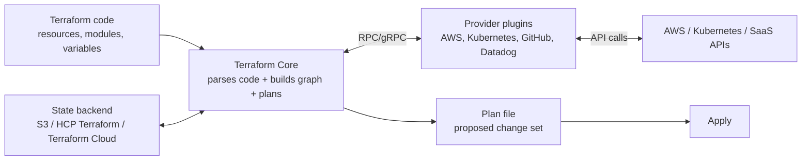
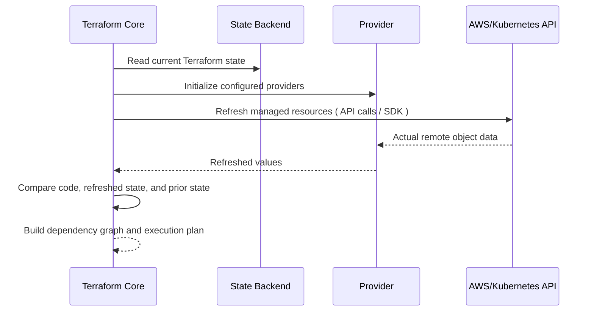

# Terraform Architecture and Execution Model

Terraform is an **execution engine for infrastructure state
transitions**.

## Contents

- [Practical mental model](#practical-mental-model)
- [Main components](#main-components)
- [What happens during \`terraform plan\`](#what-happens-during-terraform-plan)
- [Terraform state: the center of the architecture](#terraform-state-the-center-of-the-architecture)
- [Terraform Core builds a dependency graph](#terraform-core-builds-a-dependency-graph)
- [Provider architecture](#provider-architecture)
- [Modules are architecture boundaries](#modules-are-architecture-boundaries)
- [Terraform execution lifecycle](#terraform-execution-lifecycle)
- [Data sources versus managed resources](#data-sources-versus-managed-resources)
- [What Terraform is not](#what-terraform-is-not)
- [Production architecture on AWS](#production-architecture-on-aws)
- [Senior DevOps production checklist](#senior-devops-production-checklist)
- [The shortest accurate summary](#the-shortest-accurate-summary)
- [Suggested next topics for senior-level understanding](#suggested-next-topics-for-senior-level-understanding)

---

You declare the target infrastructure in code; Terraform reads the
current state, builds a dependency graph, creates a plan, and calls
provider APIs to make reality match the declared state.



## Practical mental model

```text
HCL configuration = intended infrastructure (Desired State)
Provider APIs      = actual infrastructure
State              = Terraform's record of managed infrastructure (current recorded state)
Terraform Core     = planner and orchestrator
```

## Main components

| Component | Senior DevOps interpretation |
| --- | --- |
| Terraform configuration | Desired-state definition: resources, data sources, modules, variables, and outputs |
| Terraform Core | Binary that parses HCL, resolves dependencies, calculates diffs, and orchestrates changes |
| Providers | Plugins that translate Terraform actions into AWS, Kubernetes, GitHub, and other API calls |
| State | Inventory and resource identity map; critical operational data |
| Backend | Where Terraform stores state and, usually, coordinates state locking |
| Modules | Reusable infrastructure building blocks with input/output contracts |
| Plan | Proposed change set: create, update, replace, destroy, or no-op |
| Registry | Source of versioned providers and modules |

## What happens during `terraform plan`



Terraform evaluates three sources of information:

1.  **Configuration:** What the code declares as desired.
2.  **State:** What Terraform currently believes it manages.
3.  **Real infrastructure:** What the provider reads from the remote
    API.

For example:

```text
Configuration: desired_instances = 3
State:         3 instances managed
AWS API:       only 2 instances exist
```

A normal plan refresh can detect this drift and propose creating the
missing instance, assuming the resource configuration and provider
behavior support that correction.

## Terraform state: the center of the architecture

State answers questions such as:

-   Which real AWS resource belongs to `aws_instance.web[0]`?
-   What is its actual ID?
-   Which dependencies and generated values are known?
-   What did Terraform create previously?

Example mapping:

```text
aws_instance.web[0]
        |
        v
i-0123456789abcdef0
```

State is essential because it maps Terraform resource addresses to real
infrastructure objects. Terraform can sometimes import or discover
existing objects, but it needs state to manage those objects reliably
over time.

### Remote state and locking

For teams, use a remote backend with appropriate concurrency control. On
AWS, S3 is a common state backend; locking support and configuration
depend on the Terraform version and backend setup. Recent Terraform
versions support S3-native lockfiles (`use_lockfile`); DynamoDB-based
locking is the older approach and is deprecated in current S3 backend
guidance.

```text
Engineer A ──┐
             ├── remote state + lock ── AWS
CI pipeline ─┘
```

Locking prevents concurrent Terraform operations from modifying the same
state at the same time.

State is sensitive because it may contain resource IDs, database
endpoints, credentials, or secret values. Marking an output as
`sensitive` hides it in certain CLI output, but does not automatically
remove the value from state.

## Terraform Core builds a dependency graph

Terraform does not execute resources in the order they appear in a file.
It constructs a dependency graph.

```hcl
resource "aws_vpc" "main" {}

resource "aws_subnet" "app" {
  vpc_id = aws_vpc.main.id
}

resource "aws_instance" "app" {
  subnet_id = aws_subnet.app.id
}
```

Terraform infers the dependency chain:

```text
VPC -> Subnet -> EC2 instance
```

Independent resources can be processed in parallel, while dependencies
determine the required ordering.

### Explicit dependencies

Use `depends_on` only when Terraform cannot infer a dependency through
an expression reference.

```hcl
depends_on = [aws_iam_role_policy.example]
```

Prefer implicit dependencies through resource attributes whenever
possible. Explicit dependencies can make plans more conservative and can
reduce parallelism.

## Provider architecture

Providers are separate, versioned plugins.

```text
Terraform Core
    ├── hashicorp/aws provider       -> AWS APIs
    ├── hashicorp/kubernetes         -> Kubernetes API
    ├── integrations/github          -> GitHub API
    └── datadog/datadog              -> Datadog API
```

A provider is responsible for things such as:

-   Authentication and configuration
-   Resource and data-source schemas
-   Read, create, update, and delete behavior
-   Import support
-   Retry and API error handling
-   Translating remote objects into Terraform state

Terraform Core itself is not AWS-aware. It coordinates with the AWS
provider to perform operations such as creating
`aws_eks_cluster.platform`; the provider makes the relevant SDK/API
calls.

Pin provider versions and commit `.terraform.lock.hcl` so engineers and
CI runners use consistent provider selections and checksums.

## Modules are architecture boundaries

A module is similar to an internal platform API.

```text
modules/
├── vpc/
├── eks/
├── rds/
└── application-service/

environments/
├── dev/
├── staging/
└── prod/
```

A good module exposes a small, stable contract:

```hcl
module "vpc" {
  source = "git::https://github.com/acme/terraform-aws-vpc.git?ref=v3.2.1"

  name       = "prod"
  cidr_block = "10.20.0.0/16"
}
```

Inputs describe what consumers can configure; outputs expose what
downstream modules or roots need.

**Senior-level rule:** avoid one enormous Terraform root module for an
entire organization. Use roots aligned to environment, account, region,
system, ownership, and blast-radius boundaries. Share reusable
functionality through versioned modules.

## Terraform execution lifecycle

```text
terraform init
    |
    v
Download providers/modules and configure backend

terraform validate
    |
    v
Check syntax and internal consistency

terraform plan
    |
    v
Refresh, compare desired vs actual, produce execution plan

terraform apply
    |
    v
Execute approved plan and persist state changes
```

### Typical CI/CD workflow

```text
Pull request
    |
    v
fmt + validate + static/security checks
    |
    v
terraform plan
    |
    v
Human or policy approval
    |
    v
terraform apply from protected branch
```

The plan must be tied to the reviewed commit and inputs. Avoid planning
against one commit and applying against another. For controlled
production workflows, save the plan artifact and apply that exact saved
plan after approval.

## Data sources versus managed resources

A managed resource is something Terraform is responsible for managing:

```hcl
resource "aws_s3_bucket" "logs" {
  bucket = "acme-production-logs"
}
```

A data source reads information about an existing object:

```hcl
data "aws_vpc" "existing" {
  tags = {
    Name = "shared-network"
  }
}
```

A data source does not manage the lifecycle of the VPC. This distinction
is important when adopting Terraform around existing shared
infrastructure.

## What Terraform is not

Terraform is not a continuously running reconciliation controller in the
same way Kubernetes controllers or Argo CD are.

```text
Terraform:
plan/apply runs -> changes infrastructure -> exits

Argo CD:
continuously observes -> detects drift -> reconciles according to policy
```

Terraform generally detects drift when a plan or apply performs a
refresh. Scheduled plan-based drift detection can be used when regular
drift visibility is required.

## Production architecture on AWS

A practical setup looks like this:

```text
GitHub / GitLab
    |
    v
Pull request
    |
    v
CI runner with OIDC
    |
    v
Assume short-lived AWS role
    |
    v
Terraform Core
    |
    v
S3 remote state + locking
    |
    v
AWS provider -> AWS APIs
```

Use OIDC federation rather than long-lived `AWS_ACCESS_KEY_ID`
credentials in CI.

Separate state by environment, account, region, or system boundary. For
example:

```text
s3://acme-terraform-state/
├── networking/prod/terraform.tfstate
├── platform/prod/terraform.tfstate
├── applications/prod/terraform.tfstate
└── applications/staging/terraform.tfstate
```

Avoid a single state file for the whole company. State boundaries should
reflect blast radius, ownership, permission boundaries, and change
frequency.

## Senior DevOps production checklist

-   [ ] Remote, encrypted state with locking or equivalent concurrency
    control
-   [ ] Least-privilege cloud roles per Terraform root
-   [ ] Short-lived CI credentials through OIDC
-   [ ] Protected branches and reviewed plans
-   [ ] Version pinning for Terraform, providers, and modules
-   [ ] `.terraform.lock.hcl` committed to version control
-   [ ] Small state files with clear ownership boundaries
-   [ ] Policy-as-code guardrails
-   [ ] Scheduled drift detection where required
-   [ ] State backups and a tested recovery procedure
-   [ ] No secrets in `.tfvars`, Git history, or plaintext state where
    avoidable
-   [ ] Provider/API retry behavior understood for critical resources
-   [ ] Clear destroy protection for production data stores

## The shortest accurate summary

> Terraform Core builds a dependency graph from code, uses providers to
> call external APIs, and relies on state to safely map declarative
> resource addresses to real infrastructure objects.

## Suggested next topics for senior-level understanding

| Topic | Why it matters in production |
| --- | --- |
| State internals | Understand lineage, serial numbers, resource instances, imports, and recovery |
| Graph internals | Understand graph construction, parallelism, dependencies, and replacement ordering |
| Provider internals | Understand plugin protocol, RPC, schemas, and resource lifecycle |
| Lifecycle management | Understand `create_before_destroy`, `prevent_destroy`, `ignore_changes`, and replacement behavior |
| State operations | Understand `terraform import`, `moved` blocks, `state mv`, and safe refactoring |
| CI/CD controls | Understand saved plans, approvals, OIDC, policy checks, and drift detection |
