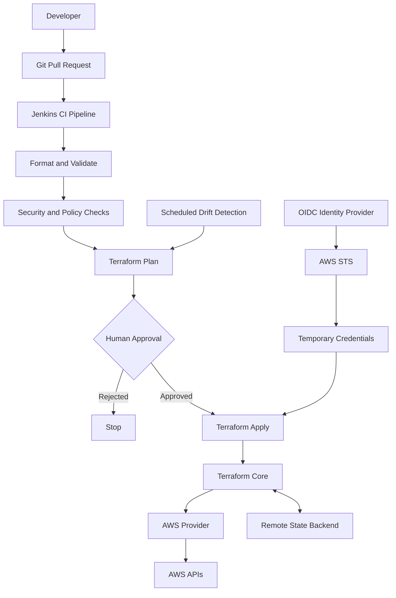

# Advanced Terraform Internals -- Senior DevOps Guide

This guide explains six important Terraform topics using practical AWS,
Kubernetes, and CI/CD examples:

## Contents

- [1.1 What is Terraform state?](#11-what-is-terraform-state)
- [1.2 Lineage and serial numbers](#12-lineage-and-serial-numbers)
- [1.3 Resource instances: \`count\` and \`for_each\`](#13-resource-instances-count-and-foreach)
- [1.4 State inspection](#14-state-inspection)
- [1.5 State backup and recovery](#15-state-backup-and-recovery)
- [2.1 Implicit dependencies and graph construction](#21-implicit-dependencies-and-graph-construction)
- [2.2 Explicit dependencies: \`depends_on\`](#22-explicit-dependencies-dependson)
- [2.3 Parallelism](#23-parallelism)
- [2.4 Replacement ordering](#24-replacement-ordering)
- [2.5 Inspecting the graph](#25-inspecting-the-graph)
- [3.1 What is a provider?](#31-what-is-a-provider)
- [3.2 Communication architecture](#32-communication-architecture)
- [3.3 What is a provider schema?](#33-what-is-a-provider-schema)
- [3.4 Resource lifecycle: CRUD](#34-resource-lifecycle-crud)
- [4.1 Default lifecycle behavior](#41-default-lifecycle-behavior)
- [4.2 \`create_before_destroy\`](#42-createbeforedestroy)
- [4.3 \`prevent_destroy\`](#43-preventdestroy)
- [4.4 \`ignore_changes\`](#44-ignorechanges)
- [4.5 \`replace_triggered_by\`](#45-replacetriggeredby)
- [4.6 Comparison](#46-comparison)
- [5.1 \`terraform import\`](#51-terraform-import)
- [5.2 Declarative import blocks](#52-declarative-import-blocks)
- [5.3 \`moved\` blocks](#53-moved-blocks)
- [5.4 \`terraform state mv\`](#54-terraform-state-mv)
- [5.5 Other useful state commands](#55-other-useful-state-commands)
- [5.6 Safe refactoring workflow](#56-safe-refactoring-workflow)
- [A. The problem: changing a resource address](#a-the-problem-changing-a-resource-address)
- [B. Option one: use a \`moved\` block](#b-option-one-use-a-moved-block)
- [C. Option two: use \`terraform state mv\`](#c-option-two-use-terraform-state-mv)
- [D. Side-by-side comparison](#d-side-by-side-comparison)
- [E. When should you use each?](#e-when-should-you-use-each)
- [F. The three layers to keep separate](#f-the-three-layers-to-keep-separate)
- [G. Important safety notes](#g-important-safety-notes)
- [H. Quick memory trick](#h-quick-memory-trick)
- [6.1 Saved plans](#61-saved-plans)
- [6.2 Approval workflows](#62-approval-workflows)
- [6.3 OIDC -- Avoid long-lived AWS credentials](#63-oidc-avoid-long-lived-aws-credentials)
- [6.4 Policy as Code](#64-policy-as-code)
- [6.5 Drift detection](#65-drift-detection)
- [A. What is the difference between Terraform state lineage and serial?](#a-what-is-the-difference-between-terraform-state-lineage-and-serial)
- [B. Why can \`for_each\` be safer than \`count\` for resources with stable identities?](#b-why-can-foreach-be-safer-than-count-for-resources-with-stable-identities)
- [C. How does Terraform decide which resources can run in parallel?](#c-how-does-terraform-decide-which-resources-can-run-in-parallel)
- [D. What is the difference between implicit and explicit dependencies?](#d-what-is-the-difference-between-implicit-and-explicit-dependencies)
- [E. How does Terraform Core communicate with a provider plugin?](#e-how-does-terraform-core-communicate-with-a-provider-plugin)
- [F. What is the difference between RPC/gRPC communication and AWS SDK/API communication?](#f-what-is-the-difference-between-rpcgrpc-communication-and-aws-sdkapi-communication)
- [G. What happens when an attribute requires resource replacement?](#g-what-happens-when-an-attribute-requires-resource-replacement)
- [H. Does \`prevent_destroy\` protect a resource after its configuration is removed?](#h-does-preventdestroy-protect-a-resource-after-its-configuration-is-removed)
- [I. What is the difference between \`terraform import\` and a data source?](#i-what-is-the-difference-between-terraform-import-and-a-data-source)
- [J. Why should you use a \`moved\` block when renaming a resource?](#j-why-should-you-use-a-moved-block-when-renaming-a-resource)
- [K. What is the difference between \`terraform state mv\` and \`moved\`?](#k-what-is-the-difference-between-terraform-state-mv-and-moved)
- [L. Why should a CI/CD pipeline apply the exact saved plan that was approved?](#l-why-should-a-cicd-pipeline-apply-the-exact-saved-plan-that-was-approved)
- [M. How does OIDC reduce the risk of leaked AWS credentials?](#m-how-does-oidc-reduce-the-risk-of-leaked-aws-credentials)
- [N. How would you implement scheduled drift detection?](#n-how-would-you-implement-scheduled-drift-detection)
- [O. Why should detected drift not automatically trigger an apply?](#o-why-should-detected-drift-not-automatically-trigger-an-apply)
- [Quick revision table](#quick-revision-table)
- [Final interview takeaway](#final-interview-takeaway)
- [9. Recommended hands-on exercises ( optional )](#9-recommended-hands-on-exercises-optional)

---

1.  State internals
2.  Graph internals
3.  Provider internals
4.  Lifecycle management
5.  State operations
6.  CI/CD controls

The goal is to understand not only which commands to run, but why
Terraform behaves the way it does.

------------------------------------------------------------------------

# 1. State Internals -- Terraform's Memory

## 1.1 What is Terraform state?

Terraform state maps Terraform resource instances to real infrastructure
objects.

Example configuration:

```hcl
resource "aws_instance" "web" {
  ami           = "ami-12345678"
  instance_type = "t3.small"
}
```

After creating the EC2 instance, AWS returns an ID:

```text
Instance ID: i-0123456789abcdef0
```

Terraform records the binding:

```text
aws_instance.web
        |
        v
i-0123456789abcdef0
```

State is not merely a copy of `.tf` files. It contains resource
identity, attributes, metadata, and information Terraform needs to
manage infrastructure over time.

## 1.2 Lineage and serial numbers

Terraform state has two important metadata fields:

-   **Lineage:** A unique identifier for a state history. It helps
    distinguish independent state histories.
-   **Serial:** A monotonically increasing number for successive
    snapshots of that state.

Example:

| Snapshot | Lineage | Serial | Contents |
| --- | --- | --- | --- |
| Initial | `abc-123` | 1 | One EC2 instance |
| Next | `abc-123` | 2 | EC2 + S3 bucket |
| Later | `abc-123` | 3 | EC2 + S3 + IAM role |
The lineage remains the same as that state history advances. The serial
increases as newer snapshots are written.

When pushing state, Terraform uses lineage and serial safeguards to help
prevent overwriting a different or newer state. The `-force` option can
bypass some protections and should be treated as dangerous.

## 1.3 Resource instances: `count` and `for_each`

With `count`:

```hcl
resource "aws_instance" "web" {
  count         = 3
  ami           = "ami-12345678"
  instance_type = "t3.small"
}
```

Terraform tracks three instances:

```text
aws_instance.web[0]
aws_instance.web[1]
aws_instance.web[2]
```

With `for_each`:

```hcl
resource "aws_instance" "app" {
  for_each = {
    frontend = "t3.small"
    backend  = "t3.medium"
  }

  ami           = "ami-12345678"
  instance_type = each.value
}
```

The addresses are:

```text
aws_instance.app["frontend"]
aws_instance.app["backend"]
```

### Why does this matter?

With `count`, removing or inserting an item in the middle of a list can
shift indexes. Terraform may then associate an index with a different
logical object, potentially causing unexpected changes.

With `for_each`, stable keys identify instances by meaningful names. For
resources with stable identities, `for_each` is often easier to
maintain.

## 1.4 State inspection

Useful commands:

```bash
terraform state list
terraform state show aws_instance.web
terraform state pull > state-backup.json
```

-   `state list` lists managed resource addresses.
-   `state show` displays a resource's state.
-   `state pull` downloads the current state and writes it to standard
    output.

State may contain sensitive values. Protect backups and command output
accordingly.

## 1.5 State backup and recovery

If production state is corrupted or overwritten:

1.  Stop concurrent Terraform operations against that state.
2.  Preserve the current state for investigation.
3.  Identify the correct previous snapshot or backend object version.
4.  Verify lineage, serial, workspace, backend, and resource contents.
5.  Restore using the backend's supported recovery process.
6.  Run a plan and carefully reconcile state with actual infrastructure.

For an S3 backend, bucket versioning can preserve previous object
versions. Also maintain access controls, encryption, and a tested
recovery procedure.

Important commands:

```bash
terraform state pull > current-state.json
terraform state list
terraform state show aws_instance.web
```

`terraform state push` can overwrite remote state and is a high-risk
operation. Terraform checks lineage and serial to prevent some unsafe
pushes. Avoid `-force` unless you fully understand the consequences and
have verified backups.

**Production rule:** Do not edit `terraform.tfstate` manually. Use
Terraform state commands and backend recovery procedures.

------------------------------------------------------------------------

# 2. Graph Internals -- How Terraform Decides Execution Order

Terraform does not execute resources in the order they appear in `.tf`
files. It builds and walks dependency graphs.

## 2.1 Implicit dependencies and graph construction

Example:

```hcl
resource "aws_vpc" "main" {
  cidr_block = "10.0.0.0/16"
}

resource "aws_subnet" "app" {
  vpc_id     = aws_vpc.main.id
  cidr_block = "10.0.1.0/24"
}

resource "aws_instance" "web" {
  ami           = "ami-12345678"
  instance_type = "t3.micro"
  subnet_id     = aws_subnet.app.id
}
```

Terraform identifies references and infers:

```text
VPC -> Subnet -> EC2
```

The subnet depends on the VPC, and the EC2 instance depends on the
subnet.

Terraform's internal graph contains more than just one node per
resource. Graph transformations can introduce nodes for provider
configuration, resource instances, data-source reads, expansion, and
operation-specific actions.

## 2.2 Explicit dependencies: `depends_on`

Implicit dependency:

```hcl
resource "aws_subnet" "app" {
  vpc_id = aws_vpc.main.id
}
```

Explicit dependency:

```hcl
resource "aws_instance" "app" {
  subnet_id = aws_subnet.app.id

  depends_on = [
    aws_iam_role_policy.example
  ]
}
```

Use `depends_on` when Terraform cannot infer a real dependency from an
expression reference. It can also order data-source reads after
dependencies.

Avoid adding unnecessary explicit dependencies because they can make
plans more conservative and reduce parallelism.

## 2.3 Parallelism

Consider three independent resources:

```hcl
resource "aws_s3_bucket" "logs" {}

resource "aws_iam_role" "app" {}

resource "aws_security_group" "app" {}
```

Because there are no dependency relationships between them, Terraform
can process their graph operations concurrently.

By default, Terraform allows up to 10 concurrent graph operations.

You can change the limit:

```bash
terraform apply -parallelism=20
```

This is a maximum concurrency limit, not a guarantee that 20 operations
will always be active. Dependencies and provider behavior can reduce
actual concurrency.

Terraform's graph walker processes a node when its dependencies have
completed. Providers may also implement their own API retries and
rate-limit handling.

## 2.4 Replacement ordering

Suppose an EC2 instance must be replaced because an attribute cannot be
updated in place.

Default replacement can be:

```text
Destroy old EC2
       |
       v
Create new EC2
```

With `create_before_destroy`:

```text
Old EC2 remains running
       |
       v
Create replacement EC2
       |
       v
Destroy old EC2
```

The second sequence is useful for reducing downtime, but only if both
objects can coexist. Unique names, IP addresses, quotas, or other API
constraints can prevent this strategy.

## 2.5 Inspecting the graph

Generate a graph in DOT format:

```bash
terraform graph
```

Render it using Graphviz:

```bash
terraform graph | dot -Tsvg > graph.svg
```

You can also inspect a graph for a saved plan:

```bash
terraform graph -plan=tfplan
```

Graph output can be complex because it exposes internal operation nodes
and dependencies.

------------------------------------------------------------------------

# 3. Provider Internals -- How Terraform Communicates with AWS

## 3.1 What is a provider?

A provider is a separate executable plugin that implements
platform-specific behavior.

Examples:

-   `hashicorp/aws` -- AWS
-   `hashicorp/kubernetes` -- Kubernetes
-   `datadog/datadog` -- Datadog
-   `integrations/github` -- GitHub

Terraform Core does not contain all the logic required to create AWS
resources. The AWS provider implements that platform-specific
functionality.

## 3.2 Communication architecture

```text
Terraform Core process
        |
        | Terraform Plugin Protocol
        | gRPC-based RPC
        v
AWS Provider process
        |
        | AWS SDK / HTTPS
        v
AWS APIs
```

There are two distinct communication layers:

1.  **Terraform Core to provider:** Terraform Plugin Protocol,
    implemented using Protocol Buffers and gRPC.
2.  **Provider to AWS:** AWS SDK and HTTPS API calls.

Providers run as separate processes from Terraform Core.

## 3.3 What is a provider schema?

A provider schema describes the resources, data sources, arguments, and
attributes supported by the provider.

Example:

```hcl
resource "aws_instance" "web" {
  ami           = "ami-12345678"
  instance_type = "t3.small"
  subnet_id     = "subnet-123456"
}
```

The provider schema defines information such as:

-   `ami`: configurable argument
-   `instance_type`: configurable argument
-   `subnet_id`: configurable argument
-   `id`: typically a computed attribute returned after creation

Provider schemas describe required, optional, computed, sensitive, and
other attribute behaviors.

Inspect a provider schema:

```bash
terraform providers schema -json
```

## 3.4 Resource lifecycle: CRUD

CRUD means:

-   Create
-   Read
-   Update
-   Delete

| Operation | Responsibility |
| --- | --- |
| Create | Create the remote object and return its ID and attributes |
| Read | Fetch current remote information and refresh state |
| Update | Modify the existing object in place |
| Delete | Delete the remote object |
Conceptual flow for creation:

```text
Terraform Core
      |
      | ApplyResourceChange RPC
      v
AWS Provider
      |
      | AWS SDK call
      v
AWS API
      |
      | Resource created, ID returned
      v
AWS Provider
      |
      | Updated resource state
      v
Terraform Core
```

The provider framework exposes lifecycle operations through resource
interfaces and Terraform RPCs.

Not every configuration change results in an Update operation. Some
attributes require replacement instead.

------------------------------------------------------------------------

# 4. Lifecycle Management -- Controlling Infrastructure Changes

Lifecycle meta-arguments influence how Terraform plans and executes
changes.

## 4.1 Default lifecycle behavior

Terraform generally:

1.  Creates resources not yet associated with remote objects.
2.  Destroys resources removed from configuration.
3.  Updates resources in place when supported.
4.  Replaces resources when an argument cannot be updated in place.

The provider's schema and planning behavior determine whether a change
requires replacement.

## 4.2 `create_before_destroy`

By default, replacement may destroy the old object before creating the
new one.

```hcl
resource "aws_instance" "web" {
  ami           = "ami-new"
  instance_type = "t3.small"

  lifecycle {
    create_before_destroy = true
  }
}
```

Terraform attempts to create the replacement before destroying the old
object.

Useful for reducing downtime, but it is not a zero-downtime guarantee.
Both resources must be able to exist simultaneously. Consider unique
names, IP addresses, quotas, load balancer registration, health checks,
and traffic switching.

Terraform can propagate this behavior through dependencies.

## 4.3 `prevent_destroy`

Protect a critical database against destructive plans:

```hcl
resource "aws_db_instance" "production" {
  identifier = "production-db"

  lifecycle {
    prevent_destroy = true
  }
}
```

Terraform rejects plans that would destroy or replace this object while
the rule remains in configuration.

Important limitation: if you remove the resource block entirely, the
lifecycle rule is also removed. `prevent_destroy` is not a permanent
protection stored on the remote database.

Use it as one safeguard alongside backups, deletion protection, IAM
controls, and approval policies.

## 4.4 `ignore_changes`

Suppose another system manages tags on an EC2 instance:

```hcl
resource "aws_instance" "web" {
  ami           = "ami-12345678"
  instance_type = "t3.small"

  tags = {
    Environment = "production"
  }

  lifecycle {
    ignore_changes = [
      tags
    ]
  }
}
```

If an external process adds an `Owner` tag, Terraform ignores tag
differences when planning updates.

Terraform still considers configured values when creating the resource.
`ignore_changes` applies to update planning.

Avoid `ignore_changes = all` casually. It can conceal important drift.

## 4.5 `replace_triggered_by`

You can trigger replacement based on changes to another managed
resource:

```hcl
lifecycle {
  replace_triggered_by = [
    aws_security_group.app
  ]
}
```

This tells Terraform to replace the resource when the referenced managed
resource or relevant attribute changes.

## 4.6 Comparison

  -----------------------------------------------------------------------
| Argument | Purpose |
| --- | --- |
| `create_before_destroy` | Create replacement before destroying old object |
| `prevent_destroy` | Reject destructive plans while configured |
| `ignore_changes` | Ignore selected attribute differences during update planning |
| `replace_triggered_by` | Trigger replacement based on changes to another managed resource |

Lifecycle settings affect graph construction and traversal. They are not
all persisted in state in the same way; notably, Terraform records
`create_before_destroy` behavior, while other lifecycle rules generally
remain configuration-based.

------------------------------------------------------------------------

# 5. State Operations -- Importing and Refactoring Infrastructure

State operations are particularly useful when adopting existing
infrastructure or reorganizing Terraform code without recreating
resources.

## 5.1 `terraform import`

Suppose an EC2 instance was created manually:

```text
i-0123456789abcdef0
```

First, define a matching resource block:

```hcl
resource "aws_instance" "web" {
  ami           = "ami-12345678"
  instance_type = "t3.small"
}
```

Then import the existing object:

```bash
terraform import aws_instance.web i-0123456789abcdef0
```

Conceptually:

```text
Existing EC2 in AWS
        |
        v
AWS Provider reads resource
        |
        v
Terraform Core receives resource data
        |
        v
State binding is created
        |
        v
aws_instance.web -> i-0123456789abcdef0
```

Import associates an existing remote object with a Terraform resource
address in state. It does not automatically generate a complete
configuration or guarantee that your configuration matches the actual
resource.

After import:

```bash
terraform plan
```

Review differences and adjust configuration before applying.

Each remote object should be bound to only one Terraform resource
instance.

## 5.2 Declarative import blocks

You can also express imports in configuration:

```hcl
resource "aws_instance" "web" {
  ami           = "ami-12345678"
  instance_type = "t3.small"
}

import {
  to = aws_instance.web
  id = "i-0123456789abcdef0"
}
```

Then:

```bash
terraform plan
terraform apply
```

This is useful in CI/CD because the import becomes part of a reviewable
configuration workflow.

## 5.3 `moved` blocks

Suppose your original resource is:

```hcl
resource "aws_instance" "web" {
  instance_type = "t3.small"
}
```

You reorganize it into a module:

```hcl
module "application" {
  source = "./modules/application"
}
```

Inside the module, the resource is now:

```hcl
resource "aws_instance" "web" {
  instance_type = "t3.small"
}
```

The resource address changes:

```text
Before:
aws_instance.web

After:
module.application.aws_instance.web
```

Without migration information, Terraform may interpret this as removing
the old address and creating a new object.

Use a `moved` block:

```hcl
moved {
  from = aws_instance.web
  to   = module.application.aws_instance.web
}
```

Terraform updates the address association in state while preserving the
existing remote object.

`moved` blocks are useful for renaming resources, moving resources into
modules, splitting modules, and changing instance addressing.

## 5.4 `terraform state mv`

You can also move an address directly in state:

```bash
terraform state mv \
  aws_instance.web \
  module.application.aws_instance.web
```

This changes the state binding. It does not move or recreate the actual
EC2 instance.

  -----------------------------------------------------------------------
| `moved` block | `terraform state mv` |
| --- | --- |
| Declared in configuration | Executed as a CLI command |
| Visible in Git | Direct state mutation |
| Processed during planning | Changes state immediately |
| Good for collaborative refactoring | Useful for imperative state changes |

For normal configuration refactoring, prefer `moved` blocks because they
document the migration.

## 5.5 Other useful state commands

```bash
terraform state list
terraform state show aws_instance.web
terraform state pull
terraform state rm aws_instance.web
terraform state replace-provider
```

`terraform state rm` removes a binding from state without destroying the
remote object. The object becomes unmanaged by that state and may be
proposed for creation again if a matching resource remains in
configuration.

## 5.6 Safe refactoring workflow

```text
1. Freeze concurrent Terraform changes
             |
             v
2. Back up current state
             |
             v
3. Change Terraform configuration
             |
             v
4. Add moved/import/removed declarations
             |
             v
5. Run terraform plan
             |
             v
6. Verify no unintended destroy/create
             |
             v
7. Review and approve
             |
             v
8. Apply
             |
             v
9. Verify state and actual infrastructure
```

For migrations between separate state files, consider the declarative
`removed` and `import` workflow where supported. Terraform 1.7
introduced configuration-driven remove-and-import workflows. Direct
cross-state `terraform state mv` is a legacy approach and requires
careful coordination.

------------------------------------------------------------------------
# Terraform Resource Address Migration: `moved` Blocks vs. `terraform state mv`

## A. The problem: changing a resource address

Suppose your Terraform configuration initially defines an EC2 instance
directly:

```hcl
resource "aws_instance" "web" {
  ami           = "ami-123456"
  instance_type = "t3.medium"
}
```

After running `terraform apply`, Terraform records a mapping in state:

```text
aws_instance.web
       |
       v
i-0123456789abcdef
```

The address `aws_instance.web` identifies the EC2 instance in
Terraform's state. It is not the EC2 instance's AWS ID; it is
Terraform's address for that object.

Now imagine you reorganize your code and move the resource into a
module:

```hcl
module "application" {
  source = "./modules/application"
}
```

Inside `modules/application/main.tf`:

```hcl
resource "aws_instance" "web" {
  ami           = "ami-123456"
  instance_type = "t3.medium"
}
```

The resource's address has changed:

| Before | After |
| --- | --- |
| `aws_instance.web` | `module.application.aws_instance.web` |
But the existing state still associates the EC2 instance with
`aws_instance.web`. Without telling Terraform about the address change,
Terraform may plan to destroy the old address and create an object at
the new address.

You want Terraform to recognize that the resource at the old address is
the same real EC2 instance now represented by the new address.

That is what `moved` blocks and `terraform state mv` are for.

## B. Option one: use a `moved` block

Add this block to your Terraform configuration:

```hcl
moved {
  from = aws_instance.web
  to   = module.application.aws_instance.web
}
```

This tells Terraform:

> This resource used to be tracked at `aws_instance.web`. It is now
> tracked at `module.application.aws_instance.web`. Treat this as an
> address migration, not as a request to replace the real
> infrastructure.

### What happens?

**Before:**

```text
aws_instance.web
       |
       v
i-0123456789abcdef
```

**After the move is applied:**

```text
module.application.aws_instance.web
       |
       v
i-0123456789abcdef
```

The EC2 instance ID stays the same. Only its Terraform state address
changes.

### Typical workflow

1.  Move the resource definition into the module.
2.  Add the `moved` block to the Terraform configuration.
3.  Run `terraform plan` and review the proposed move.
4.  Run `terraform apply` to apply the plan and commit the state
    migration.

The `moved` block is part of the configuration, so it can be committed
to Git and shared with teammates. This makes it useful for collaborative
refactoring.

## C. Option two: use `terraform state mv`

You can perform the same address migration directly from the command
line:

```bash
terraform state mv \
  aws_instance.web \
  module.application.aws_instance.web
```

This command tells Terraform to change the resource's address in state
from the old address to the new one.

**Before:**

```text
aws_instance.web
       |
       v
i-0123456789abcdef
```

**After:**

```text
module.application.aws_instance.web
       |
       v
i-0123456789abcdef
```

The command directly updates the state. It does not require
`terraform apply` to perform that state move.

Important: the Terraform configuration must also match the new address.
For example, the resource definition should actually be inside
`module.application`.

`terraform state mv` does not move, destroy, or recreate the real EC2
instance. It changes how Terraform tracks that instance.

## D. Side-by-side comparison

  -----------------------------------------------------------------------
| Feature | `moved` block | `terraform state mv` |
| --- | --- | --- |
| Approach | Declarative | Imperative |
| Where you define it | Terraform configuration (`.tf` file) | CLI command |
| When the move is | During planning | Immediately when the |
| processed |  | command runs |
| When the state change | When the plan is | The command updates |
| is committed | applied | state directly |
| Requires | Yes | No |
| `terraform apply` for |  |  |
| the move |  |  |
| Migration instructions | Yes, if the | Not in the |
| stored in Git | configuration is committed | configuration by itself |
| Useful for team-wide | Yes | Can be used, but |
| refactoring |  | requires careful coordination |
| Recreates the real | No | No |
| infrastructure |  |  |

## E. When should you use each?

### Prefer `moved` blocks for collaborative refactoring

Imagine a shared Terraform project containing:

-   A VPC
-   Five subnets
-   Ten EC2 instances
-   RDS
-   EKS
-   Several Terraform modules

Your team decides to reorganize the code and move resources into
modules.

A `moved` block is often the better choice because the migration is
declared in code and can be reviewed and shared through Git.

A typical team workflow is:

1.  Update the Terraform configuration and module structure.
2.  Add the relevant `moved` blocks.
3.  Commit the changes to Git.
4.  Have a teammate pull the changes.
5.  Run `terraform plan` and review the migration.
6.  Apply the reviewed plan.

### Use `terraform state mv` for direct, controlled state changes

This command is useful for one-off state address changes or carefully
coordinated migrations where you intentionally want to manipulate the
state directly.

Because it changes state immediately, coordinate with anyone else using
the same state and follow your team's state-locking and
change-management practices.

## F. The three layers to keep separate

It helps to distinguish these three things:

### AWS infrastructure

The real resources that exist in AWS:

-   VPCs
-   Subnets
-   EC2 instances
-   RDS databases
-   EKS clusters

### Terraform state

The record Terraform uses to map Terraform resource addresses to real
infrastructure objects.

For example:

```text
module.application.aws_instance.web
       |
       v
i-0123456789abcdef
```

### Terraform configuration

Your `.tf` files: resource blocks, modules, variables, and migration
declarations such as `moved` blocks.

Both `moved` blocks and `terraform state mv` change the relationship
between Terraform addresses and objects recorded in state. They do not
physically move AWS resources.

## G. Important safety notes

-   Review `terraform plan` before applying a configuration that
    includes `moved` blocks.
-   Back up or otherwise protect your state before performing manual
    state operations.
-   Use the same backend and workspace that manage the resource you're
    migrating.
-   Coordinate state changes with teammates. State locking helps prevent
    concurrent state writes when supported and configured by the
    backend.
-   Make sure the destination address is correct and that the
    configuration matches it.
-   Do not confuse moving a resource's Terraform address with changing
    the resource itself. A change to resource arguments can still
    independently cause an update or replacement.

## H. Quick memory trick

-   **`moved` block:** Tell Terraform in configuration that a resource's
    address has changed.
-   **`terraform state mv`:** Tell Terraform through a CLI command that
    a resource's address has changed.

**Both preserve the existing infrastructure object when used correctly.
Neither command is an AWS resource move.**

------------------------------------------------------------------------

# 6. CI/CD Controls -- Running Terraform Safely in Production

Now connect the concepts to a Jenkins pipeline.

A developer changes an EKS node group configuration and pushes a commit.
Should Jenkins immediately apply it to production? No. A production
workflow needs validation, review, approval, secure authentication, and
drift monitoring.

## 6.1 Saved plans

Generate a saved plan:

```bash
terraform plan -out=tfplan
```

Inspect it:

```bash
terraform show tfplan
```

After approval, apply the exact plan:

```bash
terraform apply tfplan
```

Why save the plan?

-   The reviewer sees the proposed operations.
-   The deployment stage applies the reviewed plan.
-   The apply stage does not silently generate a different interactive
    plan.

Saved plan files can contain configuration, state-related information,
and variable values. Treat them as sensitive artifacts. Restrict access,
protect storage, and avoid exposing them in public logs or repositories.

A saved plan can also become stale if the state changes before apply.
Terraform checks whether it is still applicable.

## 6.2 Approval workflows

Example:

```text
Developer pushes Terraform code
             |
             v
          Git PR
             |
             v
       terraform init
             |
             v
      terraform validate
             |
             v
       Security checks
             |
             v
 terraform plan -out=tfplan
             |
             v
       Human approval
             |
             v
     terraform apply tfplan
             |
             v
       AWS infrastructure
```

Example approval strategy:

| Environment | Approval |
| --- | --- |
| Dev | Automatic or lightweight review |
| QA | Team approval |
| Staging | Platform team approval |
| Production | Mandatory authorized approval |
Ensure the approved plan artifact is the one passed to apply.

## 6.3 OIDC -- Avoid long-lived AWS credentials

A common older approach is to store these in Jenkins credentials:

```text
AWS_ACCESS_KEY_ID
AWS_SECRET_ACCESS_KEY
```

These are long-lived credentials and must be protected and rotated.

Instead, use OpenID Connect (OIDC) federation when your CI identity
system supports it.

Conceptual flow:

```text
Jenkins workload
      |
      | Requests signed identity token
      v
OIDC Identity Provider
      |
      | Token
      v
AWS STS
      |
      | AssumeRoleWithWebIdentity
      v
Temporary AWS credentials
      |
      v
Terraform AWS Provider
      |
      v
AWS APIs
```

AWS STS validates the token and the IAM role trust policy, then issues
temporary credentials.

| Long-lived credentials | OIDC federation |
| --- | --- |
| Static access keys | Short-lived credentials |
| Secrets stored in CI | Federated workload identity |
| Manual rotation required | Temporary credential lifecycle |
| Greater exposure if leaked | Reduced credential exposure |
Jenkins-specific consideration: Jenkins must have a configured OIDC
identity provider or trusted workload identity integration. Do not
assume every Jenkins installation automatically issues OIDC tokens.

Configure: - AWS IAM OIDC provider - Role trust policy - Token
audience - Subject restrictions - Least-privilege permissions - Short
session duration appropriate to the job

The Terraform AWS provider can use the standard AWS web identity
credential chain.

## 6.4 Policy as Code

Suppose your organization requires:

-   No public S3 buckets.
-   Approved EC2 instance types.
-   RDS encryption.
-   Mandatory `Environment` tags.
-   Approved AWS regions.

Policy as code allows you to enforce these requirements before
deployment.

Common policy tools and frameworks include:

-   HashiCorp Sentinel
-   Open Policy Agent (OPA)
-   Terraform policy framework in HCP Terraform

Policies can be advisory or mandatory depending on the platform and
enforcement configuration.

Conceptual policy:

```text
IF resource is an S3 bucket
AND public access is enabled
THEN reject the Terraform plan
```

The goal is to catch violations before they reach production.

## 6.5 Drift detection

Suppose configuration declares:

```text
instance_type = t3.small
```

Someone manually changes AWS:

```text
instance_type = t3.medium
```

This is infrastructure drift.

A scheduled Jenkins workflow can detect it:

```text
Every day at 02:00 AM
          |
          v
      terraform init
          |
          v
      terraform plan
          |
          v
     Analyze plan output
          |
          v
     Drift detected?
        /     \
      Yes      No
       |        |
       v        v
    Notify    No action
      team
```

A normal plan refreshes managed resources and can detect differences
between actual infrastructure and configuration.

You can also run:

```bash
terraform plan -refresh-only
```

This previews state updates based on remote changes without proposing
configuration-driven infrastructure changes.

Important: detecting drift does not mean you should automatically apply
a correction. First determine whether the external change was
intentional.

------------------------------------------------------------------------

# 7. Putting Everything Together -- Production Terraform Architecture



Each of the six topics contributes to this architecture:

  -----------------------------------------------------------------------
| Topic | Production responsibility |
| --- | --- |
| State internals | Preserve resource identity and recover safely |
| Graph internals | Determine dependencies and execution order |
| Provider internals | Communicate with cloud APIs |
| Lifecycle management | Control replacement, destruction, and drift handling |
| State operations | Adopt and refactor infrastructure safely |
| CI/CD controls | Secure and govern infrastructure changes |

------------------------------------------------------------------------

# 8. Advanced Terraform Interview Questions --- 15 Detailed Answers

These notes cover Terraform state internals, resource identity,
dependency graphs, provider communication, lifecycle behavior, state
refactoring, CI/CD safety, OIDC, and drift detection.

Examples use AWS where useful.

------------------------------------------------------------------------

## A. What is the difference between Terraform state lineage and serial?

Both are metadata stored in Terraform state, but they answer different
questions.

-   **Lineage** identifies the state history or state family. It helps
    Terraform determine whether two state snapshots belong to the same
    state.
-   **Serial** is a monotonically increasing number for snapshots within
    that state lineage. It helps Terraform identify which snapshot is
    newer.

Think of lineage as the identity of a state history and serial as the
version number within that history.

Example:

```text
State snapshot A:
  lineage = abc-123
  serial  = 10

State snapshot B:
  lineage = abc-123
  serial  = 11
```

These snapshots belong to the same state history, and B is newer.

But:

```text
State snapshot C:
  lineage = xyz-999
  serial  = 11
```

C has the same serial number as B but a different lineage. It belongs to
a different state history.

Terraform uses these values as safety checks for state operations such
as pushing state. They help prevent accidentally overwriting a state
with an unrelated or older snapshot. They are not substitutes for
backups or locking.

------------------------------------------------------------------------

## B. Why can `for_each` be safer than `count` for resources with stable identities?

`count` identifies instances by numeric index. `for_each` identifies
instances by map key or set member.

Example using `count`:

```hcl
variable "users" {
  default = ["alice", "bob", "charlie"]
}

resource "aws_iam_user" "example" {
  count = length(var.users)
  name  = var.users[count.index]
}
```

Terraform addresses these instances as:

```text
aws_iam_user.example[0]  # alice
aws_iam_user.example[1]  # bob
aws_iam_user.example[2]  # charlie
```

Now remove `bob` from the middle:

```hcl
users = ["alice", "charlie"]
```

The indexes shift:

```text
[0] = alice
[1] = charlie
```

Terraform may interpret the old `[1]` instance (Bob) as needing to
become Charlie, and the old `[2]` instance (Charlie) as needing removal.
Depending on resource attributes and provider behavior, this can cause
unnecessary updates, replacements, or destroys/creates.

Using `for_each`:

```hcl
variable "users" {
  type = set(string)
  default = ["alice", "bob", "charlie"]
}

resource "aws_iam_user" "example" {
  for_each = var.users
  name     = each.key
}
```

Addresses become:

```text
aws_iam_user.example["alice"]
aws_iam_user.example["bob"]
aws_iam_user.example["charlie"]
```

Removing Bob removes only the `"bob"` instance. Alice and Charlie keep
their identities.

**Rule of thumb:** Use `count` for interchangeable, position-based
instances. Use `for_each` when instances have meaningful, stable
identities.

Important caveat: `for_each` keys must be known before Terraform
performs remote resource operations. Do not use values that are only
known after apply as instance keys.

------------------------------------------------------------------------

## C. How does Terraform decide which resources can run in parallel?

Terraform builds a dependency graph from the configuration, state, and
planned operations.

A resource can run when all of its dependencies have completed.
Independent graph nodes can be processed concurrently, subject to
Terraform's parallelism limit.

Example:

```hcl
resource "aws_vpc" "main" {
  cidr_block = "10.0.0.0/16"
}

resource "aws_subnet" "app" {
  vpc_id     = aws_vpc.main.id
  cidr_block = "10.0.1.0/24"
}

resource "aws_s3_bucket" "logs" {
  bucket = "example-company-logs"
}
```

The subnet depends on the VPC because it references `aws_vpc.main.id`.
The S3 bucket is independent.

Conceptually:

```text
          Create VPC
              |
              v
          Create Subnet

          Create S3 bucket
          (independent)
```

Terraform can create the VPC and S3 bucket concurrently. It must wait
for the VPC before creating the subnet.

The default parallelism limit is 10 operations. You can change it:

```bash
terraform apply -parallelism=5
```

Parallelism does not mean Terraform starts every resource at once.
Dependencies, provider behavior, graph operations, and the configured
parallelism limit constrain execution.

------------------------------------------------------------------------

## D. What is the difference between implicit and explicit dependencies?

### Implicit dependency

Terraform infers a dependency from an expression reference.

```hcl
resource "aws_vpc" "main" {
  cidr_block = "10.0.0.0/16"
}

resource "aws_subnet" "app" {
  vpc_id     = aws_vpc.main.id
  cidr_block = "10.0.1.0/24"
}
```

Because the subnet references `aws_vpc.main.id`, Terraform knows that
the VPC must exist before the subnet is created.

### Explicit dependency

Use `depends_on` when there is a real dependency that Terraform cannot
infer from an argument reference.

```hcl
resource "aws_iam_role_policy_attachment" "app" {
  role       = aws_iam_role.app.name
  policy_arn = aws_iam_policy.app.arn
}

resource "aws_instance" "app" {
  ami           = "ami-0123456789abcdef0"
  instance_type = "t3.small"
  subnet_id     = aws_subnet.app.id

  depends_on = [
    aws_iam_role_policy_attachment.app
  ]
}
```

This tells Terraform to wait for the policy attachment operation before
operating on the instance.

**Prefer implicit dependencies when possible.** They are more precise
because Terraform knows which value creates the relationship. Use
`depends_on` only for hidden behavioral dependencies; excessive use can
make plans more conservative and reduce parallelism.

------------------------------------------------------------------------

## E. How does Terraform Core communicate with a provider plugin?

Terraform providers are separate executable plugins. Terraform Core
starts the provider process and communicates with it through the
Terraform Plugin Protocol, which is based on RPC and uses gRPC in modern
protocol versions.

Conceptually:

```text
Terraform CLI
     |
Terraform Core
     |
     | Plugin protocol (RPC/gRPC)
     v
AWS Provider process
     |
     | AWS SDK / HTTPS API requests
     v
AWS services
```

A typical flow:

1.  Terraform initializes and discovers the required provider.
2.  Terraform starts the provider plugin process.
3.  Core and the provider establish the plugin protocol connection.
4.  Core asks the provider for its schema and invokes operations such as
    configure, plan, read, create, update, or delete.
5.  The provider performs the relevant cloud API calls and returns
    results to Core.

The provider implements the resource and data source behavior. Terraform
Core orchestrates the overall workflow and dependency graph.

------------------------------------------------------------------------

## F. What is the difference between RPC/gRPC communication and AWS SDK/API communication?

They are two different communication layers.

### Terraform Core to AWS provider

-   Protocol: Terraform Plugin Protocol, using RPC/gRPC in modern
    versions.
-   Participants: Terraform Core and the provider plugin process.
-   Purpose: Ask the provider to perform Terraform operations and return
    schema, planned values, diagnostics, and resource results.

### AWS provider to AWS

-   Protocol: AWS service APIs, generally HTTPS.
-   Client library: AWS SDK used by the provider.
-   Participants: AWS provider and AWS services.
-   Purpose: Create, read, update, and delete AWS resources.

Example:

```text
Terraform Core
     |
     | RPC/gRPC: "Read this EC2 resource"
     v
AWS Provider
     |
     | AWS SDK over HTTPS: DescribeInstances
     v
Amazon EC2 API
```

Core does not normally call the EC2 API directly. It asks the AWS
provider to perform the operation. The provider uses its AWS SDK to
communicate with AWS.

------------------------------------------------------------------------

## G. What happens when an attribute requires resource replacement?

Some resource attributes can be updated in place. Other changes require
the resource to be destroyed and recreated.

The provider's resource schema and planning behavior determine whether a
change can be updated or requires replacement.

Example: changing an EC2 instance attribute that requires replacement
may produce a plan like:

```text
-/+ resource "aws_instance" "app" {
      subnet_id = "subnet-old" -> "subnet-new" # forces replacement
  }
```

By default, `-/+` means Terraform destroys the old object and then
creates the new one.

You can request create-before-destroy behavior:

```hcl
resource "aws_instance" "app" {
  # ...

  lifecycle {
    create_before_destroy = true
  }
}
```

The plan may then show:

```text
+/- resource "aws_instance" "app" {
      # replacement
  }
```

This means Terraform attempts to create the replacement before
destroying the old object.

Considerations: - Both objects must be able to exist at the same time. -
Unique names, fixed addresses, quotas, or other constraints can prevent
overlap. - Creating a new instance does not automatically move
application traffic. - Load balancer registration, health checks, and
traffic switching may be needed for a low-downtime rollout.

Replacement is a graph operation, not simply a text edit. Terraform must
preserve dependency ordering around the old and new objects.

------------------------------------------------------------------------

## H. Does `prevent_destroy` protect a resource after its configuration is removed?

No. `prevent_destroy` is a lifecycle rule in the resource configuration.
It protects against a destroy plan while that resource configuration,
including the lifecycle rule, remains present.

Example:

```hcl
resource "aws_db_instance" "production" {
  # ...

  lifecycle {
    prevent_destroy = true
  }
}
```

If a proposed operation would destroy this resource while the block
remains configured, Terraform rejects the plan.

But if you remove the entire resource block from the configuration, the
lifecycle rule is removed too. Terraform no longer has that rule
available to protect the object, and it can plan to destroy the resource
because it is no longer declared.

Therefore: - `prevent_destroy` is a useful guardrail. - It is not a
permanent protection attached to the cloud resource. - It does not
replace backups, IAM controls, approval gates, or operational
safeguards.

------------------------------------------------------------------------

## I. What is the difference between `terraform import` and a data source?

They serve different purposes.

### Import

Import brings an existing real object under Terraform state management.

For example, an EC2 instance already exists in AWS and you want
Terraform to manage its lifecycle.

Declarative import block:

```hcl
import {
  to = aws_instance.app
  id = "i-0123456789abcdef0"
}

resource "aws_instance" "app" {
  # Write the matching resource configuration.
}
```

Then:

```bash
terraform plan
terraform apply
```

Import associates the existing object with a Terraform resource address.
You still need appropriate resource configuration. Import does not
automatically generate a complete configuration in every workflow, nor
does it mean Terraform should recreate the object.

### Data source

A data source reads information about an object but does not take
ownership of its lifecycle.

```hcl
data "aws_vpc" "existing" {
  id = "vpc-0123456789abcdef0"
}

resource "aws_subnet" "app" {
  vpc_id     = data.aws_vpc.existing.id
  cidr_block = "10.0.1.0/24"
}
```

Terraform reads the existing VPC and uses its ID to create a subnet. It
does not manage the VPC as a resource.

**In short:** - Import: bring an existing object into Terraform
management/state. - Data source: read an existing object without
managing its lifecycle.

------------------------------------------------------------------------

## J. Why should you use a `moved` block when renaming a resource?

Terraform identifies managed objects by their resource addresses in
state.

Suppose you rename:

```hcl
resource "aws_instance" "app" {
  # ...
}
```

to:

```hcl
resource "aws_instance" "application" {
  # ...
}
```

Without telling Terraform about the address change, it may interpret the
old address as removed and the new address as a new resource. That can
lead to a destroy/create plan.

Use a `moved` block:

```hcl
moved {
  from = aws_instance.app
  to   = aws_instance.application
}
```

Terraform can then treat the change as a state address move rather than
a request to replace the real EC2 instance.

The moved block: - Documents the refactor in version-controlled
configuration. - Helps teammates and CI use the same migration. -
Supports repeatable upgrades for users of a module. - Avoids requiring
each user to run a manual state command.

Keep moved blocks long enough to support the upgrade paths you intend to
support.

------------------------------------------------------------------------

## K. What is the difference between `terraform state mv` and `moved`?

Both change the association between a state address and a configuration
address, but they differ in how the change is expressed and shared.

### `terraform state mv`

An imperative CLI operation:

```bash
terraform state mv \
  aws_instance.app \
  aws_instance.application
```

It directly modifies the state currently selected by the CLI/backend.

Useful for controlled one-time state refactoring, but every relevant
environment/state must be handled carefully.

### `moved` block

A declarative migration in configuration:

```hcl
moved {
  from = aws_instance.app
  to   = aws_instance.application
}
```

Terraform processes the migration as part of normal planning. It is
version controlled and can be applied consistently by team members and
CI.

**Rule of thumb:** - Use `moved` blocks for repeatable, collaborative
refactoring. - Use `terraform state mv` for controlled state surgery or
situations where a configuration-based migration is not practical.

Always back up state and review the plan before and after either
operation.

------------------------------------------------------------------------

## L. Why should a CI/CD pipeline apply the exact saved plan that was approved?

Suppose Jenkins runs:

```bash
terraform plan -out=tfplan
```

A reviewer inspects that plan and approves it.

The pipeline should then run:

```bash
terraform apply tfplan
```

This applies the saved plan that was reviewed, subject to Terraform's
validity checks.

If the pipeline instead runs a fresh:

```bash
terraform apply
```

Terraform creates a new plan. The configuration, state, provider
observations, or external infrastructure may have changed since
approval. The new plan may therefore contain actions the reviewer never
approved.

A saved plan helps maintain the relationship:

```text
Plan generated
     |
     v
Human/policy review
     |
     v
Approval
     |
     v
Apply that saved plan
```

Saved plan files can contain sensitive information. Store them as
protected CI artifacts, restrict access, and avoid committing them to
Git. A saved plan can also become stale; Terraform may reject it if the
state has changed in a way that invalidates the plan.

------------------------------------------------------------------------

## M. How does OIDC reduce the risk of leaked AWS credentials?

Without OIDC, a CI pipeline may rely on long-lived AWS access keys
stored as Jenkins credentials.

If those keys leak through logs, compromised agents, artifacts, or
misconfiguration, an attacker may be able to use them until they are
revoked or expire according to their key status.

With OIDC, Jenkins or another supported CI identity provider issues a
signed identity token. AWS STS can validate that token through a
configured IAM OIDC identity provider and an IAM role trust policy. If
the claims match the trust policy, STS returns temporary AWS
credentials.

Conceptually:

```text
Jenkins job
    |
    | OIDC identity token
    v
AWS STS AssumeRoleWithWebIdentity
    |
    | Validate issuer, audience, subject, trust policy
    v
Temporary AWS credentials
    |
    v
AWS APIs
```

Benefits: - No long-lived AWS access key needs to be stored in the
pipeline. - Credentials are temporary and expire. - IAM trust can
restrict which repository, branch, environment, or workload may assume
the role, depending on token claims and integration. - Access can be
scoped to a least-privilege IAM role.

OIDC does not eliminate all credential risk. Temporary credentials can
still be stolen from a compromised runner while valid. Protect runners,
restrict trust policies, and limit IAM permissions.

------------------------------------------------------------------------

## N. How would you implement scheduled drift detection?

A common approach is to run a scheduled, read-oriented Terraform plan in
CI/CD.

Example Jenkins pipeline:

``` groovy
pipeline {
  agent any

  triggers {
    cron('H 2 * * *')
  }

  stages {
    stage('Checkout') {
      steps {
        checkout scm
      }
    }

    stage('Terraform Init') {
      steps {
        sh 'terraform init'
      }
    }

    stage('Drift Check') {
      steps {
        sh '''
          terraform plan \
            -detailed-exitcode \
            -no-color
        '''
      }
    }
  }

  post {
    always {
      archiveArtifacts artifacts: 'tfplan*',
                     allowEmptyArchive: true
    }
  }
}
```

For a more structured workflow, save the plan:

```bash
terraform plan -out=tfplan -detailed-exitcode
```

`-detailed-exitcode` returns: - `0`: successful plan, no changes. - `1`:
error. - `2`: successful plan, changes present.

The pipeline should interpret exit code 2 as a drift/change signal, not
automatically as a failure or permission to apply.

A robust drift workflow: 1. Run on a schedule, such as nightly. 2. Use a
dedicated least-privilege identity. 3. Initialize the correct backend
and workspace. 4. Run a normal refresh-enabled plan. 5. Capture and
classify the plan output. 6. Notify the infrastructure owner or create
an incident/ticket. 7. Require investigation and approval before
remediation. 8. Keep plan artifacts protected because they can contain
sensitive data.

For large estates, run drift checks per root module/state rather than
one giant state.

------------------------------------------------------------------------

## O. Why should detected drift not automatically trigger an apply?

Drift means the real infrastructure differs from Terraform's desired
configuration. It does not automatically mean the real infrastructure is
wrong.

Examples: - An engineer made an emergency production fix. - An
autoscaling system changed capacity. - A managed service changed a
computed attribute. - Another approved automation changed an object. - A
manual change was intentional but has not yet been reflected in code.

If a scheduled job automatically applies every detected difference, it
could: - Undo a valid emergency change. - Cause downtime or
replacement. - Fight with autoscalers or other controllers. - Remove an
intentional security or networking change. - Apply a plan based on
incomplete context.

A safer process:

```text
Scheduled Terraform plan
          |
          v
      Drift found?
       /       \
     No         Yes
     |           |
  Record       Notify owner
  clean        and preserve plan
                |
                v
          Investigate change
                |
        +-------+--------+
        |                |
   Intentional       Unintended
        |                |
 Update code/state   Review remediation
 as appropriate      and blast radius
                         |
                         v
                   Human approval
                         |
                         v
                    Apply reviewed plan
```

**Key principle:** Detection should be automated; remediation should be
governed. Automatically correcting drift is appropriate only when the
resource, ownership, risk, and remediation policy are explicitly
designed for it.

------------------------------------------------------------------------

## Quick revision table

  ------------------------------------------------------------------------
| \# | Topic | Core idea |
| --- | --- | --- |
| 1 | Lineage vs serial | Lineage identifies state history; serial orders snapshots within it |
| 2 | `for_each` vs `count` | Stable keys avoid index shifting when collection members change |
| 3 | Parallelism | Independent graph nodes can run concurrently, within the parallelism limit |
| 4 | Implicit vs explicit dependencies | References infer dependencies; `depends_on` declares hidden dependencies |
| 5 | Core to provider | Terraform Plugin Protocol using RPC/gRPC in modern versions |
| 6 | RPC vs AWS SDK/API | Core talks to provider; provider talks to AWS |
| 7 | Replacement | Provider planning behavior marks changes requiring destroy/create |
| 8 | `prevent_destroy` | Only protects while its resource configuration remains |
| 9 | Import vs data source | Import manages an existing object; data source only reads it |
| 10 | `moved` block | Records an address refactor so Terraform does not treat it as replacement |
| 11 | `state mv` vs `moved` | Imperative state edit vs declarative, version-controlled migration |
| 12 | Saved plan | Apply the exact reviewed plan, not a newly generated one |
| 13 | OIDC | Exchanges trusted identity token for temporary AWS credentials |
| 14 | Scheduled drift detection | Run a scheduled plan and report changes |
| 15 | No automatic drift apply | Drift may be intentional; investigate and approve remediation |

## Final interview takeaway

Terraform is not just a tool that compares `.tf` files with cloud
resources. It maintains state identity, constructs a dependency graph,
coordinates provider plugins, plans lifecycle operations, and uses state
and backend safeguards to make infrastructure changes predictable.

In production, safe Terraform operation depends just as much on state
management, identity, approvals, and drift governance as it does on
writing correct HCL.

----------------------------------------------------------

## 9. Recommended hands-on exercises ( optional )

Try these in a non-production AWS account.

-   [ ] Create three EC2 instances using `count`.
-   [ ] Repeat using `for_each` and stable keys.
-   [ ] Inspect state using `terraform state list` and
    `terraform state show`.
-   [ ] Change an EC2 tag manually and run `terraform plan`.
-   [ ] Use `terraform graph` and render the dependency graph.
-   [ ] Test `create_before_destroy` on a resource that permits
    concurrent replacement.
-   [ ] Test `prevent_destroy` on a disposable resource.
-   [ ] Test `ignore_changes` with externally managed tags.
-   [ ] Import an existing test resource into Terraform.
-   [ ] Rename a resource using a `moved` block.
-   [ ] Generate a saved plan and apply that exact plan.
-   [ ] Configure a CI workload to assume an AWS role using OIDC.
-   [ ] Run a scheduled plan and notify on drift.

------------------------------------------------------------------------

# 10. Final Mental Model

Remember these six responsibilities:

```text
STATE
Remembers which real resources Terraform manages.

GRAPH
Understands dependencies and determines execution ordering.

PROVIDER
Translates Terraform operations into platform API calls.

LIFECYCLE
Controls how resources are created, updated, replaced, and destroyed.

STATE OPERATIONS
Allow existing resources and resource addresses to be adopted or reorganized safely.

CI/CD
Ensures infrastructure changes are validated, reviewed, authorized, and monitored.
```

> Senior-level Terraform engineering is not just writing HCL. It is
> managing infrastructure identity, dependency ordering, provider
> behavior, lifecycle risk, state integrity, and controlled deployment
> workflows.
