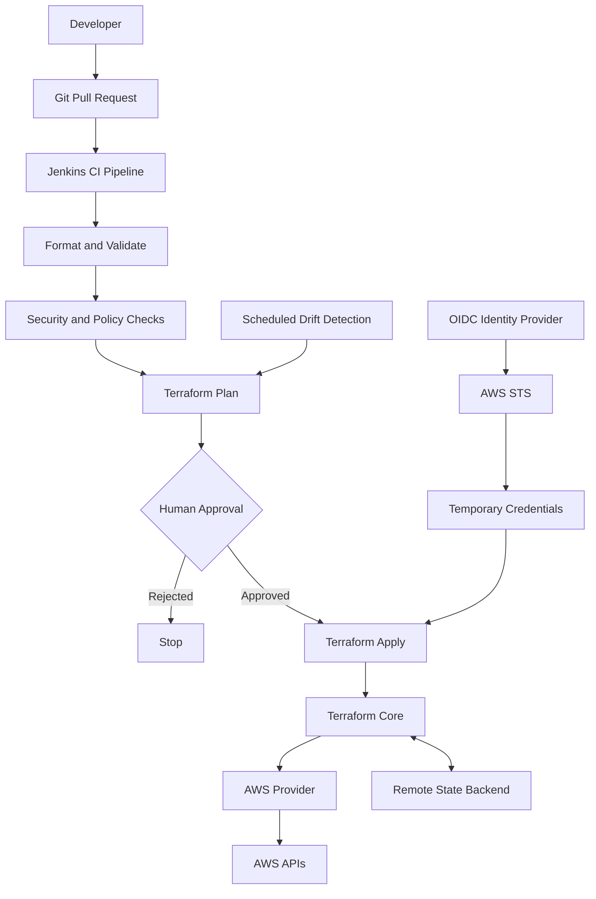

# Advanced Terraform Internals -- Senior DevOps Guide

This guide explains six important Terraform topics using practical AWS,
Kubernetes, and CI/CD examples:

1.  State internals
2.  Graph internals
3.  Provider internals
4.  Lifecycle management
5.  State operations
6.  CI/CD controls

The goal is to understand not only which commands to run, but why
Terraform behaves the way it does.

------------------------------------------------------------------------

# 1. State Internals -- Terraform's Memory

## 1.1 What is Terraform state?

Terraform state maps Terraform resource instances to real infrastructure
objects.

Example configuration:

``` hcl
resource "aws_instance" "web" {
  ami           = "ami-12345678"
  instance_type = "t3.small"
}
```

After creating the EC2 instance, AWS returns an ID:

``` text
Instance ID: i-0123456789abcdef0
```

Terraform records the binding:

``` text
aws_instance.web
        |
        v
i-0123456789abcdef0
```

State is not merely a copy of `.tf` files. It contains resource
identity, attributes, metadata, and information Terraform needs to
manage infrastructure over time.

## 1.2 Lineage and serial numbers

Terraform state has two important metadata fields:

-   **Lineage:** A unique identifier for a state history. It helps
    distinguish independent state histories.
-   **Serial:** A monotonically increasing number for successive
    snapshots of that state.

Example:

  Snapshot   Lineage       Serial Contents
  ---------- ----------- -------- ---------------------
  Initial    `abc-123`          1 One EC2 instance
  Next       `abc-123`          2 EC2 + S3 bucket
  Later      `abc-123`          3 EC2 + S3 + IAM role

The lineage remains the same as that state history advances. The serial
increases as newer snapshots are written.

When pushing state, Terraform uses lineage and serial safeguards to help
prevent overwriting a different or newer state. The `-force` option can
bypass some protections and should be treated as dangerous.

## 1.3 Resource instances: `count` and `for_each`

With `count`:

``` hcl
resource "aws_instance" "web" {
  count         = 3
  ami           = "ami-12345678"
  instance_type = "t3.small"
}
```

Terraform tracks three instances:

``` text
aws_instance.web[0]
aws_instance.web[1]
aws_instance.web[2]
```

With `for_each`:

``` hcl
resource "aws_instance" "app" {
  for_each = {
    frontend = "t3.small"
    backend  = "t3.medium"
  }

  ami           = "ami-12345678"
  instance_type = each.value
}
```

The addresses are:

``` text
aws_instance.app["frontend"]
aws_instance.app["backend"]
```

### Why does this matter?

With `count`, removing or inserting an item in the middle of a list can
shift indexes. Terraform may then associate an index with a different
logical object, potentially causing unexpected changes.

With `for_each`, stable keys identify instances by meaningful names. For
resources with stable identities, `for_each` is often easier to
maintain.

## 1.4 State inspection

Useful commands:

``` bash
terraform state list
terraform state show aws_instance.web
terraform state pull > state-backup.json
```

-   `state list` lists managed resource addresses.
-   `state show` displays a resource's state.
-   `state pull` downloads the current state and writes it to standard
    output.

State may contain sensitive values. Protect backups and command output
accordingly.

## 1.5 State backup and recovery

If production state is corrupted or overwritten:

1.  Stop concurrent Terraform operations against that state.
2.  Preserve the current state for investigation.
3.  Identify the correct previous snapshot or backend object version.
4.  Verify lineage, serial, workspace, backend, and resource contents.
5.  Restore using the backend's supported recovery process.
6.  Run a plan and carefully reconcile state with actual infrastructure.

For an S3 backend, bucket versioning can preserve previous object
versions. Also maintain access controls, encryption, and a tested
recovery procedure.

Important commands:

``` bash
terraform state pull > current-state.json
terraform state list
terraform state show aws_instance.web
```

`terraform state push` can overwrite remote state and is a high-risk
operation. Terraform checks lineage and serial to prevent some unsafe
pushes. Avoid `-force` unless you fully understand the consequences and
have verified backups.

**Production rule:** Do not edit `terraform.tfstate` manually. Use
Terraform state commands and backend recovery procedures.

------------------------------------------------------------------------

# 2. Graph Internals -- How Terraform Decides Execution Order

Terraform does not execute resources in the order they appear in `.tf`
files. It builds and walks dependency graphs.

## 2.1 Implicit dependencies and graph construction

Example:

``` hcl
resource "aws_vpc" "main" {
  cidr_block = "10.0.0.0/16"
}

resource "aws_subnet" "app" {
  vpc_id     = aws_vpc.main.id
  cidr_block = "10.0.1.0/24"
}

resource "aws_instance" "web" {
  ami           = "ami-12345678"
  instance_type = "t3.micro"
  subnet_id     = aws_subnet.app.id
}
```

Terraform identifies references and infers:

``` text
VPC -> Subnet -> EC2
```

The subnet depends on the VPC, and the EC2 instance depends on the
subnet.

Terraform's internal graph contains more than just one node per
resource. Graph transformations can introduce nodes for provider
configuration, resource instances, data-source reads, expansion, and
operation-specific actions.

## 2.2 Explicit dependencies: `depends_on`

Implicit dependency:

``` hcl
resource "aws_subnet" "app" {
  vpc_id = aws_vpc.main.id
}
```

Explicit dependency:

``` hcl
resource "aws_instance" "app" {
  subnet_id = aws_subnet.app.id

  depends_on = [
    aws_iam_role_policy.example
  ]
}
```

Use `depends_on` when Terraform cannot infer a real dependency from an
expression reference. It can also order data-source reads after
dependencies.

Avoid adding unnecessary explicit dependencies because they can make
plans more conservative and reduce parallelism.

## 2.3 Parallelism

Consider three independent resources:

``` hcl
resource "aws_s3_bucket" "logs" {}

resource "aws_iam_role" "app" {}

resource "aws_security_group" "app" {}
```

Because there are no dependency relationships between them, Terraform
can process their graph operations concurrently.

By default, Terraform allows up to 10 concurrent graph operations.

You can change the limit:

``` bash
terraform apply -parallelism=20
```

This is a maximum concurrency limit, not a guarantee that 20 operations
will always be active. Dependencies and provider behavior can reduce
actual concurrency.

Terraform's graph walker processes a node when its dependencies have
completed. Providers may also implement their own API retries and
rate-limit handling.

## 2.4 Replacement ordering

Suppose an EC2 instance must be replaced because an attribute cannot be
updated in place.

Default replacement can be:

``` text
Destroy old EC2
       |
       v
Create new EC2
```

With `create_before_destroy`:

``` text
Old EC2 remains running
       |
       v
Create replacement EC2
       |
       v
Destroy old EC2
```

The second sequence is useful for reducing downtime, but only if both
objects can coexist. Unique names, IP addresses, quotas, or other API
constraints can prevent this strategy.

## 2.5 Inspecting the graph

Generate a graph in DOT format:

``` bash
terraform graph
```

Render it using Graphviz:

``` bash
terraform graph | dot -Tsvg > graph.svg
```

You can also inspect a graph for a saved plan:

``` bash
terraform graph -plan=tfplan
```

Graph output can be complex because it exposes internal operation nodes
and dependencies.

------------------------------------------------------------------------

# 3. Provider Internals -- How Terraform Communicates with AWS

## 3.1 What is a provider?

A provider is a separate executable plugin that implements
platform-specific behavior.

Examples:

-   `hashicorp/aws` -- AWS
-   `hashicorp/kubernetes` -- Kubernetes
-   `datadog/datadog` -- Datadog
-   `integrations/github` -- GitHub

Terraform Core does not contain all the logic required to create AWS
resources. The AWS provider implements that platform-specific
functionality.

## 3.2 Communication architecture

``` text
Terraform Core process
        |
        | Terraform Plugin Protocol
        | gRPC-based RPC
        v
AWS Provider process
        |
        | AWS SDK / HTTPS
        v
AWS APIs
```

There are two distinct communication layers:

1.  **Terraform Core to provider:** Terraform Plugin Protocol,
    implemented using Protocol Buffers and gRPC.
2.  **Provider to AWS:** AWS SDK and HTTPS API calls.

Providers run as separate processes from Terraform Core.

## 3.3 What is a provider schema?

A provider schema describes the resources, data sources, arguments, and
attributes supported by the provider.

Example:

``` hcl
resource "aws_instance" "web" {
  ami           = "ami-12345678"
  instance_type = "t3.small"
  subnet_id     = "subnet-123456"
}
```

The provider schema defines information such as:

-   `ami`: configurable argument
-   `instance_type`: configurable argument
-   `subnet_id`: configurable argument
-   `id`: typically a computed attribute returned after creation

Provider schemas describe required, optional, computed, sensitive, and
other attribute behaviors.

Inspect a provider schema:

``` bash
terraform providers schema -json
```

## 3.4 Resource lifecycle: CRUD

CRUD means:

-   Create
-   Read
-   Update
-   Delete

  Operation   Responsibility
  ----------- -----------------------------------------------------------
  Create      Create the remote object and return its ID and attributes
  Read        Fetch current remote information and refresh state
  Update      Modify the existing object in place
  Delete      Delete the remote object

Conceptual flow for creation:

``` text
Terraform Core
      |
      | ApplyResourceChange RPC
      v
AWS Provider
      |
      | AWS SDK call
      v
AWS API
      |
      | Resource created, ID returned
      v
AWS Provider
      |
      | Updated resource state
      v
Terraform Core
```

The provider framework exposes lifecycle operations through resource
interfaces and Terraform RPCs.

Not every configuration change results in an Update operation. Some
attributes require replacement instead.

------------------------------------------------------------------------

# 4. Lifecycle Management -- Controlling Infrastructure Changes

Lifecycle meta-arguments influence how Terraform plans and executes
changes.

## 4.1 Default lifecycle behavior

Terraform generally:

1.  Creates resources not yet associated with remote objects.
2.  Destroys resources removed from configuration.
3.  Updates resources in place when supported.
4.  Replaces resources when an argument cannot be updated in place.

The provider's schema and planning behavior determine whether a change
requires replacement.

## 4.2 `create_before_destroy`

By default, replacement may destroy the old object before creating the
new one.

``` hcl
resource "aws_instance" "web" {
  ami           = "ami-new"
  instance_type = "t3.small"

  lifecycle {
    create_before_destroy = true
  }
}
```

Terraform attempts to create the replacement before destroying the old
object.

Useful for reducing downtime, but it is not a zero-downtime guarantee.
Both resources must be able to exist simultaneously. Consider unique
names, IP addresses, quotas, load balancer registration, health checks,
and traffic switching.

Terraform can propagate this behavior through dependencies.

## 4.3 `prevent_destroy`

Protect a critical database against destructive plans:

``` hcl
resource "aws_db_instance" "production" {
  identifier = "production-db"

  lifecycle {
    prevent_destroy = true
  }
}
```

Terraform rejects plans that would destroy or replace this object while
the rule remains in configuration.

Important limitation: if you remove the resource block entirely, the
lifecycle rule is also removed. `prevent_destroy` is not a permanent
protection stored on the remote database.

Use it as one safeguard alongside backups, deletion protection, IAM
controls, and approval policies.

## 4.4 `ignore_changes`

Suppose another system manages tags on an EC2 instance:

``` hcl
resource "aws_instance" "web" {
  ami           = "ami-12345678"
  instance_type = "t3.small"

  tags = {
    Environment = "production"
  }

  lifecycle {
    ignore_changes = [
      tags
    ]
  }
}
```

If an external process adds an `Owner` tag, Terraform ignores tag
differences when planning updates.

Terraform still considers configured values when creating the resource.
`ignore_changes` applies to update planning.

Avoid `ignore_changes = all` casually. It can conceal important drift.

## 4.5 `replace_triggered_by`

You can trigger replacement based on changes to another managed
resource:

``` hcl
lifecycle {
  replace_triggered_by = [
    aws_security_group.app
  ]
}
```

This tells Terraform to replace the resource when the referenced managed
resource or relevant attribute changes.

## 4.6 Comparison

  -----------------------------------------------------------------------
  Argument                            Purpose
  ----------------------------------- -----------------------------------
  `create_before_destroy`             Create replacement before
                                      destroying old object

  `prevent_destroy`                   Reject destructive plans while
                                      configured

  `ignore_changes`                    Ignore selected attribute
                                      differences during update planning

  `replace_triggered_by`              Trigger replacement based on
                                      changes to another managed resource
  -----------------------------------------------------------------------

Lifecycle settings affect graph construction and traversal. They are not
all persisted in state in the same way; notably, Terraform records
`create_before_destroy` behavior, while other lifecycle rules generally
remain configuration-based.

------------------------------------------------------------------------

# 5. State Operations -- Importing and Refactoring Infrastructure

State operations are particularly useful when adopting existing
infrastructure or reorganizing Terraform code without recreating
resources.

## 5.1 `terraform import`

Suppose an EC2 instance was created manually:

``` text
i-0123456789abcdef0
```

First, define a matching resource block:

``` hcl
resource "aws_instance" "web" {
  ami           = "ami-12345678"
  instance_type = "t3.small"
}
```

Then import the existing object:

``` bash
terraform import aws_instance.web i-0123456789abcdef0
```

Conceptually:

``` text
Existing EC2 in AWS
        |
        v
AWS Provider reads resource
        |
        v
Terraform Core receives resource data
        |
        v
State binding is created
        |
        v
aws_instance.web -> i-0123456789abcdef0
```

Import associates an existing remote object with a Terraform resource
address in state. It does not automatically generate a complete
configuration or guarantee that your configuration matches the actual
resource.

After import:

``` bash
terraform plan
```

Review differences and adjust configuration before applying.

Each remote object should be bound to only one Terraform resource
instance.

## 5.2 Declarative import blocks

You can also express imports in configuration:

``` hcl
resource "aws_instance" "web" {
  ami           = "ami-12345678"
  instance_type = "t3.small"
}

import {
  to = aws_instance.web
  id = "i-0123456789abcdef0"
}
```

Then:

``` bash
terraform plan
terraform apply
```

This is useful in CI/CD because the import becomes part of a reviewable
configuration workflow.

## 5.3 `moved` blocks

Suppose your original resource is:

``` hcl
resource "aws_instance" "web" {
  instance_type = "t3.small"
}
```

You reorganize it into a module:

``` hcl
module "application" {
  source = "./modules/application"
}
```

Inside the module, the resource is now:

``` hcl
resource "aws_instance" "web" {
  instance_type = "t3.small"
}
```

The resource address changes:

``` text
Before:
aws_instance.web

After:
module.application.aws_instance.web
```

Without migration information, Terraform may interpret this as removing
the old address and creating a new object.

Use a `moved` block:

``` hcl
moved {
  from = aws_instance.web
  to   = module.application.aws_instance.web
}
```

Terraform updates the address association in state while preserving the
existing remote object.

`moved` blocks are useful for renaming resources, moving resources into
modules, splitting modules, and changing instance addressing.

## 5.4 `terraform state mv`

You can also move an address directly in state:

``` bash
terraform state mv \
  aws_instance.web \
  module.application.aws_instance.web
```

This changes the state binding. It does not move or recreate the actual
EC2 instance.

  -----------------------------------------------------------------------
  `moved` block                       `terraform state mv`
  ----------------------------------- -----------------------------------
  Declared in configuration           Executed as a CLI command

  Visible in Git                      Direct state mutation

  Processed during planning           Changes state immediately

  Good for collaborative refactoring  Useful for imperative state changes
  -----------------------------------------------------------------------

For normal configuration refactoring, prefer `moved` blocks because they
document the migration.

## 5.5 Other useful state commands

``` bash
terraform state list
terraform state show aws_instance.web
terraform state pull
terraform state rm aws_instance.web
terraform state replace-provider
```

`terraform state rm` removes a binding from state without destroying the
remote object. The object becomes unmanaged by that state and may be
proposed for creation again if a matching resource remains in
configuration.

## 5.6 Safe refactoring workflow

``` text
1. Freeze concurrent Terraform changes
             |
             v
2. Back up current state
             |
             v
3. Change Terraform configuration
             |
             v
4. Add moved/import/removed declarations
             |
             v
5. Run terraform plan
             |
             v
6. Verify no unintended destroy/create
             |
             v
7. Review and approve
             |
             v
8. Apply
             |
             v
9. Verify state and actual infrastructure
```

For migrations between separate state files, consider the declarative
`removed` and `import` workflow where supported. Terraform 1.7
introduced configuration-driven remove-and-import workflows. Direct
cross-state `terraform state mv` is a legacy approach and requires
careful coordination.

------------------------------------------------------------------------

# 6. CI/CD Controls -- Running Terraform Safely in Production

Now connect the concepts to a Jenkins pipeline.

A developer changes an EKS node group configuration and pushes a commit.
Should Jenkins immediately apply it to production? No. A production
workflow needs validation, review, approval, secure authentication, and
drift monitoring.

## 6.1 Saved plans

Generate a saved plan:

``` bash
terraform plan -out=tfplan
```

Inspect it:

``` bash
terraform show tfplan
```

After approval, apply the exact plan:

``` bash
terraform apply tfplan
```

Why save the plan?

-   The reviewer sees the proposed operations.
-   The deployment stage applies the reviewed plan.
-   The apply stage does not silently generate a different interactive
    plan.

Saved plan files can contain configuration, state-related information,
and variable values. Treat them as sensitive artifacts. Restrict access,
protect storage, and avoid exposing them in public logs or repositories.

A saved plan can also become stale if the state changes before apply.
Terraform checks whether it is still applicable.

## 6.2 Approval workflows

Example:

``` text
Developer pushes Terraform code
             |
             v
          Git PR
             |
             v
       terraform init
             |
             v
      terraform validate
             |
             v
       Security checks
             |
             v
 terraform plan -out=tfplan
             |
             v
       Human approval
             |
             v
     terraform apply tfplan
             |
             v
       AWS infrastructure
```

Example approval strategy:

  Environment   Approval
  ------------- ---------------------------------
  Dev           Automatic or lightweight review
  QA            Team approval
  Staging       Platform team approval
  Production    Mandatory authorized approval

Ensure the approved plan artifact is the one passed to apply.

## 6.3 OIDC -- Avoid long-lived AWS credentials

A common older approach is to store these in Jenkins credentials:

``` text
AWS_ACCESS_KEY_ID
AWS_SECRET_ACCESS_KEY
```

These are long-lived credentials and must be protected and rotated.

Instead, use OpenID Connect (OIDC) federation when your CI identity
system supports it.

Conceptual flow:

``` text
Jenkins workload
      |
      | Requests signed identity token
      v
OIDC Identity Provider
      |
      | Token
      v
AWS STS
      |
      | AssumeRoleWithWebIdentity
      v
Temporary AWS credentials
      |
      v
Terraform AWS Provider
      |
      v
AWS APIs
```

AWS STS validates the token and the IAM role trust policy, then issues
temporary credentials.

  Long-lived credentials       OIDC federation
  ---------------------------- --------------------------------
  Static access keys           Short-lived credentials
  Secrets stored in CI         Federated workload identity
  Manual rotation required     Temporary credential lifecycle
  Greater exposure if leaked   Reduced credential exposure

Jenkins-specific consideration: Jenkins must have a configured OIDC
identity provider or trusted workload identity integration. Do not
assume every Jenkins installation automatically issues OIDC tokens.

Configure: - AWS IAM OIDC provider - Role trust policy - Token
audience - Subject restrictions - Least-privilege permissions - Short
session duration appropriate to the job

The Terraform AWS provider can use the standard AWS web identity
credential chain.

## 6.4 Policy as Code

Suppose your organization requires:

-   No public S3 buckets.
-   Approved EC2 instance types.
-   RDS encryption.
-   Mandatory `Environment` tags.
-   Approved AWS regions.

Policy as code allows you to enforce these requirements before
deployment.

Common policy tools and frameworks include:

-   HashiCorp Sentinel
-   Open Policy Agent (OPA)
-   Terraform policy framework in HCP Terraform

Policies can be advisory or mandatory depending on the platform and
enforcement configuration.

Conceptual policy:

``` text
IF resource is an S3 bucket
AND public access is enabled
THEN reject the Terraform plan
```

The goal is to catch violations before they reach production.

## 6.5 Drift detection

Suppose configuration declares:

``` text
instance_type = t3.small
```

Someone manually changes AWS:

``` text
instance_type = t3.medium
```

This is infrastructure drift.

A scheduled Jenkins workflow can detect it:

``` text
Every day at 02:00 AM
          |
          v
      terraform init
          |
          v
      terraform plan
          |
          v
     Analyze plan output
          |
          v
     Drift detected?
        /     \
      Yes      No
       |        |
       v        v
    Notify    No action
      team
```

A normal plan refreshes managed resources and can detect differences
between actual infrastructure and configuration.

You can also run:

``` bash
terraform plan -refresh-only
```

This previews state updates based on remote changes without proposing
configuration-driven infrastructure changes.

Important: detecting drift does not mean you should automatically apply
a correction. First determine whether the external change was
intentional.

------------------------------------------------------------------------

# 7. Putting Everything Together -- Production Terraform Architecture



Each of the six topics contributes to this architecture:

  -----------------------------------------------------------------------
  Topic                               Production responsibility
  ----------------------------------- -----------------------------------
  State internals                     Preserve resource identity and
                                      recover safely

  Graph internals                     Determine dependencies and
                                      execution order

  Provider internals                  Communicate with cloud APIs

  Lifecycle management                Control replacement, destruction,
                                      and drift handling

  State operations                    Adopt and refactor infrastructure
                                      safely

  CI/CD controls                      Secure and govern infrastructure
                                      changes
  -----------------------------------------------------------------------

------------------------------------------------------------------------

# 8. Senior DevOps Interview Questions

Use these to check whether you understand the internals rather than only
memorizing commands.

1.  What is the difference between Terraform state lineage and serial?
2.  Why can `for_each` be safer than `count` for resources with stable
    identities?
3.  How does Terraform decide which resources can run in parallel?
4.  What is the difference between implicit and explicit dependencies?
5.  How does Terraform Core communicate with a provider plugin?
6.  What is the difference between RPC/gRPC communication and AWS
    SDK/API communication?
7.  What happens when an attribute requires resource replacement?
8.  Does `prevent_destroy` protect a resource after its configuration is
    removed?
9.  What is the difference between `terraform import` and a data source?
10. Why should you use a `moved` block when renaming a resource?
11. What is the difference between `terraform state mv` and `moved`?
12. Why should a CI/CD pipeline apply the exact saved plan that was
    approved?
13. How does OIDC reduce the risk of leaked AWS credentials?
14. How would you implement scheduled drift detection?
15. Why should a detected drift not automatically trigger an apply?

## 9. Recommended hands-on exercises

Try these in a non-production AWS account.

-   [ ] Create three EC2 instances using `count`.
-   [ ] Repeat using `for_each` and stable keys.
-   [ ] Inspect state using `terraform state list` and
    `terraform state show`.
-   [ ] Change an EC2 tag manually and run `terraform plan`.
-   [ ] Use `terraform graph` and render the dependency graph.
-   [ ] Test `create_before_destroy` on a resource that permits
    concurrent replacement.
-   [ ] Test `prevent_destroy` on a disposable resource.
-   [ ] Test `ignore_changes` with externally managed tags.
-   [ ] Import an existing test resource into Terraform.
-   [ ] Rename a resource using a `moved` block.
-   [ ] Generate a saved plan and apply that exact plan.
-   [ ] Configure a CI workload to assume an AWS role using OIDC.
-   [ ] Run a scheduled plan and notify on drift.

------------------------------------------------------------------------

# 10. Final Mental Model

Remember these six responsibilities:

``` text
STATE
Remembers which real resources Terraform manages.

GRAPH
Understands dependencies and determines execution ordering.

PROVIDER
Translates Terraform operations into platform API calls.

LIFECYCLE
Controls how resources are created, updated, replaced, and destroyed.

STATE OPERATIONS
Allow existing resources and resource addresses to be adopted or reorganized safely.

CI/CD
Ensures infrastructure changes are validated, reviewed, authorized, and monitored.
```

> Senior-level Terraform engineering is not just writing HCL. It is
> managing infrastructure identity, dependency ordering, provider
> behavior, lifecycle risk, state integrity, and controlled deployment
> workflows.
